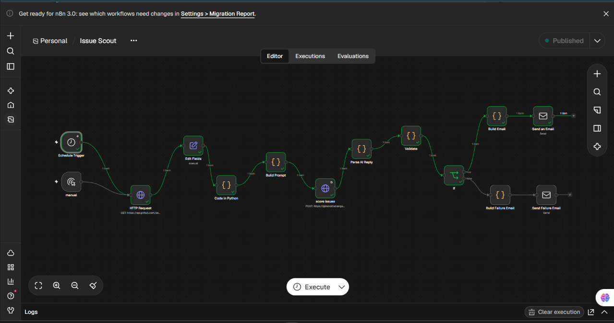
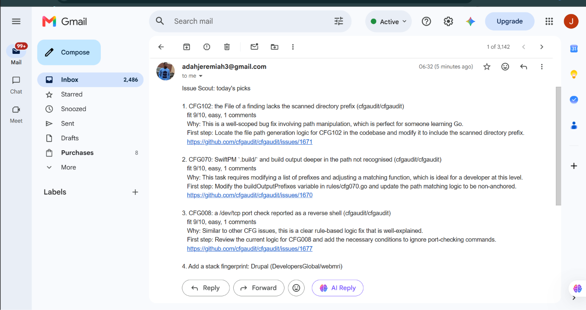
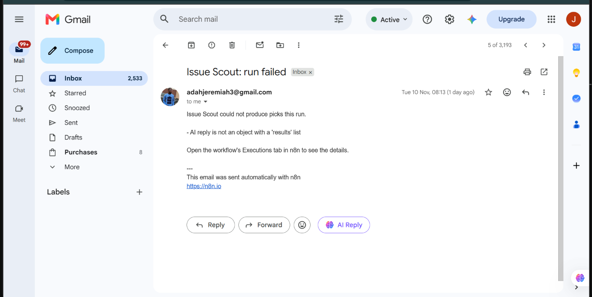

# Issue Scout

**A daily open-source issue scout. It searches GitHub, filters out the junk, asks an AI to rank what's left against my skills, validates the answer, and emails me the top 5.**

Built with **n8n + Python + a Gemini model** as my individual capstone for the CTA AI & Automation course.




---

## The problem

Finding an open-source issue that is beginner-friendly, still available, and a good match for my skills can take up to an hour of scrolling through GitHub. Many results are stale, already assigned, or too hard, so contributing keeps getting postponed.

**Target user:** me, a developer learning Go (beginner to intermediate) who wants regular open-source contribution practice.

**Outcome:** every morning I get 5 vetted issues, each with a fit score, a difficulty rating, a reason, and a suggested first step.

## How it works

```
Schedule (07:00) ─┐
                  ├─► GitHub search ─► Add cutoff date ─► Python: Filter ─► Python: Build prompt
Manual trigger ───┘
                                                                                     │
Send email ◄─ Python: Build email ◄─ IF ok? ◄─ Python: Validate ◄─ JS: Parse ◄─ Gemini scores issues
                                       │ no
                                       └─► Python: Build failure email ─► Send failure email
```

| Stage | What happens | Tool |
|---|---|---|
| **Trigger** | Daily at 07:00 (Africa/Lagos), or a manual run for demos | n8n Schedule + Manual trigger |
| **Fetch** | GitHub search API: open, unassigned `good first issue` items in Go repositories, newest first | n8n HTTP Request |
| **Filter** | Drops pull requests, assigned issues, issues untouched for 90+ days, issues with short or missing descriptions, busy threads (10+ comments) and duplicates. Keeps up to 15 clean candidates | **Python** (`scout/filter.py`) |
| **Prompt** | Builds one numbered prompt (Context, Task, Format, Constraints) from the candidates | **Python** (`scout/prompt.py`) |
| **AI decision** | A Gemini model scores each issue 1 to 10, rates difficulty, explains why, and suggests a first step, returned as JSON | **Gemini** (`gemini-3.1-flash-lite`) |
| **Parse** | Turns the AI's JSON text into a real object | n8n Code (JavaScript) |
| **Validate** | Checks every field of the AI's answer against the real candidates and keeps the top 5 | **Python** (`scout/validate.py`) |
| **Action** | Emails an HTML digest with real GitHub links, or a failure alert if validation fails | **Python** (`scout/email_builder.py`) + n8n Send Email |


## Example result



### My test run

*(Fill in with your real numbers from the run in the screenshots. Do not estimate.)*

| Measure | Result |
|---|---|
| Date of run | `[date]` |
| Issues fetched from GitHub | `[30]` |
| Candidates after filtering | `[15]` |
| Picks in the email | `[5]` |
| Picks I manually checked and found open and unassigned | `[X of 5]` |
| Time to find issues manually, before | `[about 1 hour]` |
| Time to read the digest, now | `[about 2 minutes]` |

## Responsible-AI practices

AI output is treated as **untrusted until checked**:

1. **Validation against real data.** The AI refers to issues by number only. Python rejects any number that isn't a real candidate, so the AI cannot invent an issue. Each issue's title, repository and link come from GitHub's data, never from the AI.
2. **Strict output checks.** Scores must be whole numbers from 1 to 10 and difficulty must be `easy`, `medium` or `hard`. Anything else is dropped and logged.
3. **No AI-written links.** Any AI text containing a link is rejected, so the only links in the email are genuine GitHub issue links. This also limits phishing through prompt injection.
4. **Prompt-injection defence.** Issue text is written by strangers. The prompt tells the model to treat it as data to evaluate and never as instructions, and the validator is a second layer if that fails.
5. **Safe email output.** All text is HTML-escaped, and only `https://github.com/` links are made clickable.
6. **Human in the loop.** The tool only recommends. It never comments on or claims issues, and every email says the scores are AI-generated and must be checked.
7. **Privacy.** Only public GitHub data and a generic skill profile are sent to the AI. No personal data is included. Secrets live in n8n credentials and are never committed.
8. **Failure transparency.** If the AI's reply can't be used, I get an alert email instead of silence.



## Tests

26 unit tests cover the Python logic (filter rules, prompt building, validation and email building), using sample data in `tests/`.

```bash
python3 -m pytest -q
```

## Setup

1. **n8n:** import `workflow/issue-scout.json` (Workflows, then Import from file).
2. **Create three credentials in n8n:**
   - *GitHub Token:* Header Auth, name `Authorization`, value `Bearer <fine-grained token, public repos read-only>`
   - *Gemini Key:* Header Auth, name `Authorization`, value `Bearer <Google AI Studio key>`
   - *SMTP:* Gmail with an app password (host `smtp.gmail.com`, port 465, SSL on)
3. **Python nodes:** n8n Cloud's Python sandbox cannot import local files, so each Python Code node contains the matching module from `scout/` (pasted in) plus a short wrapper at the bottom.
4. **Set the timezone** in the workflow settings and **activate** the workflow so the schedule runs.

Never commit keys or tokens. Credentials are not included in the workflow export.


## Challenges and what I learned

- **n8n's Python sandbox allows no imports**, not even `datetime`, and blocks some built-ins. I rewrote the filter to compare dates as text, passed the cutoff date in from n8n, and used a small JavaScript node for the one job Python can't do there (parsing JSON).
- **A third-party AI gateway returned a bot-check page** instead of JSON, which crashed the n8n AI node. I switched to Google AI Studio and called its API through an HTTP Request node.
- **A model name was retired, and the replacement was briefly overloaded.** I listed the available models, picked a stable one, and added retries and a timeout.
- **The AI's JSON arrived as plain text** after an Edit Fields step, so the validator rejected it. That confirmed the validator works, and I parsed the reply properly instead.
- **The IF node read my condition as text**, routing everything to "true". Switching the field to an expression fixed it, and I tested the failure path on purpose.

## Limitations and next steps

- Fit scores are the AI's judgment and are not verified. Reading the issue is still my job.
- The filter can't tell whether someone has already announced work in a comment or opened a linked pull request.
- It is limited to one search (Go, `good first issue`). Next: more languages and a rotating set of searches.
- n8n Cloud's trial is time-limited. **Planned:** run the same Python logic standalone on a GitHub Actions schedule, so the project keeps running without n8n.

## Repository layout

```
issue-scout/
├── scout/            filter.py, prompt.py, validate.py, email_builder.py
├── tests/            unit tests + sample_issues.json + sample_ai_response.json
├── workflow/         issue-scout.json (n8n export)
├── docs/             screenshots
├── requirements.txt
└── README.md
```

---

*Built by Jerrie as the individual capstone for the CTA AI & Automation course. Feedback and ideas welcome.*
